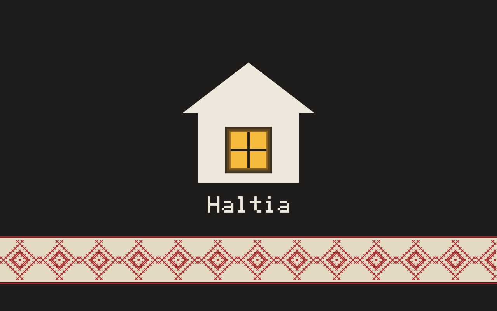

<p align="center"></p>

<h1 align="center">Haltia</h1>

<p align="center"><b>A calm touch desktop that takes care of you</b><br>
Спокойная сенсорная среда, которая о вас заботится</p>

Haltia началась с одного планшета. Отцу автора 73 года, и он очень любит
свою Lenovo YOGA Tablet 10. Lenovo давно перестала её обновлять, браузер и
программы перестали работать. Вместо нового планшета на нём теперь
современный Linux и спокойная среда, сделанная под его руки и глаза.
Халтия в финских и карельских сказках — дух-хранитель, который тихо
присматривает за домом и его хозяевами. Pertin haltia — хранитель избы:
так называются готовые образы для планшетов.

*Haltia began with one tablet. The author's father is 73 and loves his
Lenovo YOGA Tablet 10, which Lenovo stopped updating long ago. Instead of a
new tablet it now runs a current Linux and a calm desktop made for his hands
and eyes. In Finnish and Karelian tales a haltia is a guardian spirit that
quietly looks after a house and its people.*

Знак Haltia — карельский ромб с рогами, оберег с вышитых полотенец
([brand](https://github.com/haltia-de/.github/tree/main/brand)).

<p align="center"></p>

## Чем Haltia отличается

Haltia — спокойная сенсорная среда для Linux: для тех, кому нужно, чтобы
просто работало, и в первую очередь для пожилых людей.

- **Крупно и ясно.** Большие кнопки и плитки, крупный текст, одна программа на
  экране и кнопка «✕» всегда на одном месте.
- **Касание прощает.** Фильтр касаний не замечает дрожь руки, лежащую на
  стекле ладонь и случайный повторный тап; каждое касание отзывается
  лёгкой вибрацией.
- **Ничего не надо запоминать.** Всё, что можно сделать, видно на экране
  кнопкой; жесты от края — лишь короткий путь для тех, кто захочет.
- **Старое устройство снова служит.** Haltia работает на планшете 2014 года
  с 1 ГБ памяти; программы лёгкие и рисуют сами, без требований к видеокарте.
- **Свои программы, без лишнего.** Файлы и галерея, блокнот, календарь,
  видео, новости, раскраска, браузер — каждая делает одно дело и не
  отвлекает.

## Для тех, кто настраивает планшет близким

Чаще всего Haltia ставит не тот, кто будет ею пользоваться, а его дети или
внуки. Настройте один раз — Wi-Fi, вход в мессенджер и музыку, закреплённые
программы на панели — и дальше планшет просто работает. Обновления приходят
обычными пакетами (`apk upgrade`), их можно ставить удалённо по SSH, не
трогая планшет. Настройки, история и вход в программы при обновлении
сохраняются.

## Что внутри

- **[shell](https://github.com/haltia-de/shell)** — оболочка на phoc (Wayland): домашний
  экран с плитками, панель с крупными кнопками, кнопка закрытия, фильтр
  касаний для неуверенной руки (ладонь, дрожь, повторы), мультитач, экранная
  клавиатура, поворот экрана, тема GTK.
- **Программы** (GTK 3): [files](https://github.com/haltia-de/files) (Файлы и Галерея),
  [text](https://github.com/haltia-de/text), [calendar](https://github.com/haltia-de/calendar),
  [video](https://github.com/haltia-de/video), [news](https://github.com/haltia-de/news),
  [paint](https://github.com/haltia-de/paint) (раскраска по номерам),
  [firefox](https://github.com/haltia-de/firefox) (Firefox для сенсорного экрана и слабого железа)
  и для российских сервисов — [messenger](https://github.com/haltia-de/messenger) (MAX),
  [music](https://github.com/haltia-de/music) (Яндекс Музыка), [weather](https://github.com/haltia-de/weather) (Gismeteo).
- **[kit](https://github.com/haltia-de/kit)** — общая библиотека программ: вопросы, настройки, звук, фото.
- **[packages](https://github.com/haltia-de/packages)** — подписанный репозиторий apk
  для Alpine и postmarketOS.
- **[ci](https://github.com/haltia-de/ci)** — общий выпуск пакетов по тегам.
- **[device-lenovo-b8000h](https://github.com/haltia-de/device-lenovo-b8000h)** —
  Pertin Haltia для Lenovo YOGA Tablet 10 B8000-H: ядро Linux 7.1, GPU через
  libhybris, готовые образы для прошивки.

## Установка

Планшет B8000-H — образ Pertin Haltia из
[выпусков](https://github.com/haltia-de/device-lenovo-b8000h/releases).

Alpine 3.24 или postmarketOS:

```sh
wget -O /etc/apk/keys/haltia-de-6ad4bb12.rsa.pub https://haltia-de.github.io/packages/haltia-de-6ad4bb12.rsa.pub
echo https://haltia-de.github.io/packages/alpine/v3.24 >> /etc/apk/repositories
apk update && apk add haltia-desktop        # и haltia-desktop-ru
```

Пока пакеты собраны для armv7; aarch64 и x86_64 — в работе.

Решения проекта — в [ADR](https://github.com/haltia-de/device-lenovo-b8000h/tree/main/docs/adr)
(Haltia — ADR 0004). Интерфейс на русском; перевод — позже.
